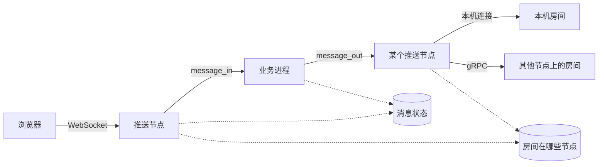

# 第一步改动说明

这次只做了房间推送闭环，没有做诊断 Agent、知识库和人工批准。TeLink 原来按用户推送：客户端走 TCP 和 Protobuf，登录后把 `userId` 记到 Redis，下行用 gRPC `push2Link` 找到人所在的机器再写回连接。这条链路还在，端口仍是 TCP `9999`、gRPC `10001`。房间能力默认关闭，不带启动参数时，原来的中台和以前一样起来。

新链路给浏览器用。页面通过 WebSocket 建房或进房，再发文本消息。推送节点确认这条连接已经在房间里，生成 `logId`，写入 Kafka `message_in`，然后回 `MESSAGE_ACCEPTED`。独立的业务进程消费后原样写入 `message_out`，第一版不改内容。某个推送节点消费下行记录，查 Redis 里这个房间还在哪些机器上：本机有连接就直接广播，其他机器走现有 gRPC 端口把消息送过去。对方只广播自己的连接，不再继续转发。房间内的人，包括发送者，收到 `MESSAGE_DELIVERED`。

和更早那版口头方案比，有四处不一样。

节点之间没有改成 Redis 发布订阅。TeLink 已经有 gRPC 和 Nacos，发布订阅也补不了失败结果，所以房间转发加在 `10001` 上，和 `push2Link` 并列，不新开端口。开启房间时，Nacos 元数据里会多一个 WebSocket 端口。

`MESSAGE_ACCEPTED` 和 `MESSAGE_DELIVERED` 不要求先到后到。前者只表示 Kafka 已经收下，后者要等业务进程和房间路由走完。验收看的是两条都到、`logId` 相同。

验收不连 `RedisConfig` 里的远程地址。一个进程里拉起多个真实 WebSocket 端口和 gRPC 端口，Kafka、Redis、MySQL 用同一套接口的内存实现。生产启动仍走真实中间件。这样多节点「只发给在房间里的机器」可以在本地重复跑，不必先准备三台机器。

消息状态只允许向前：已收到、已进入队列、业务处理完、正在路由、失败、已投递。后写的低状态不会覆盖高状态，所以投递成功之后，迟到的「已进入队列」不会把记录改回去。成功投递也可以盖过此前的失败。

实现过程中还收了两个口子。房间链路不默认启动，避免本机没有 Kafka 或 MySQL 时把旧中台带挂。Redis 地址和密码改成可用启动参数覆盖，默认值仍是原来的远程地址和原密码，避免房间目录和旧的机器编号各连一套 Redis。

自动验收覆盖了同一房间两个连接、停掉业务进程后只有受理没有投递、未入房节点负责转发时消息只到有人的节点、断开连接后清掉房间成员、状态不回退，以及登录、心跳、`push2Link` 仍在原处。手工页面在 `TeLink-UserClient/index.html`，用来开两个浏览器看同一房间。业务进程目前只是把消息原样送回去，风控、历史和登录都不在这一步。
